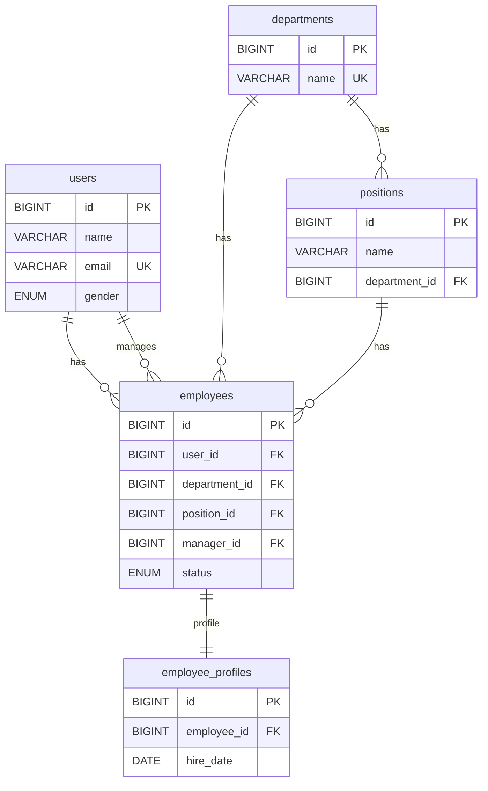
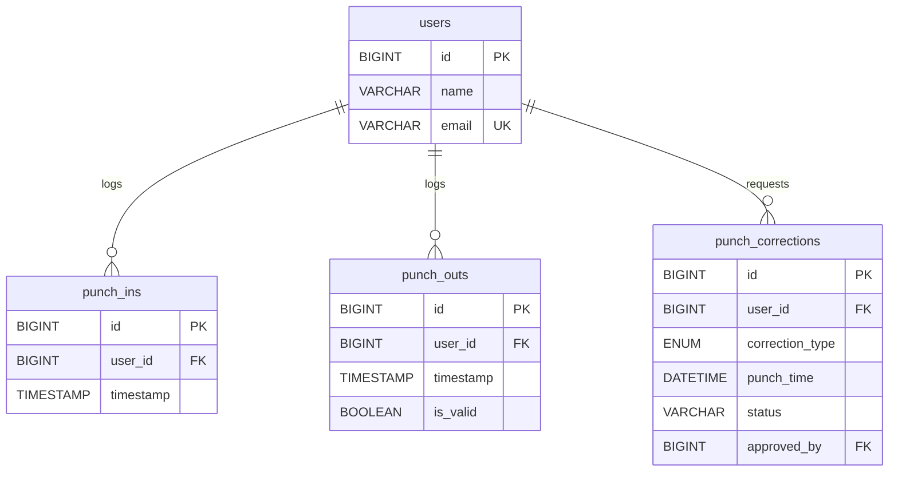
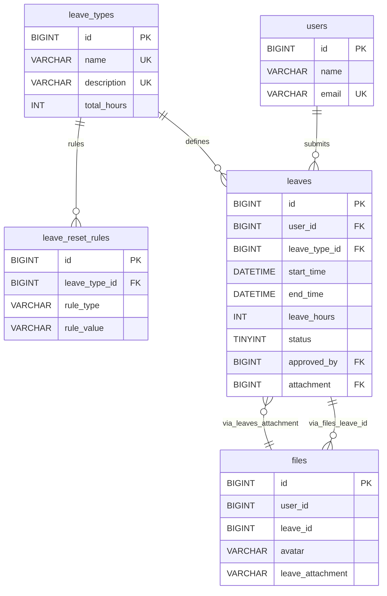
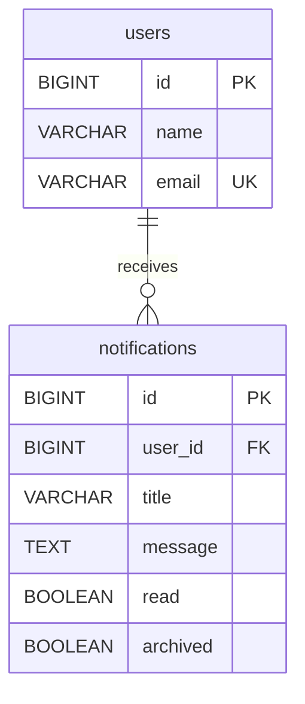
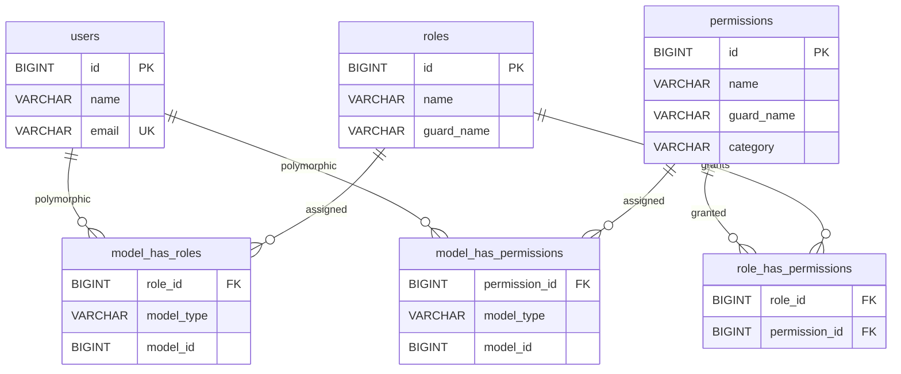

# Punch-System

**Tech Stack:** React × Laravel × WebSocket × (Optional) Vue 3  

本檔僅說明 **專案結構** 與 **目錄用途**；各子系統的安裝與啟動流程，請至對應資料夾內的 `README.md` 查看。

---

## 目錄結構

```text
punch-system/
├─ backendapi/                 # Laravel 11 (API-only) 
│  ├─ storage/api-docs/        # Swagger JSON (api-docs.json)
│  └─ README.md
├─ frontend/                   # React 19 SPA 
│  └─ README.md
├─ frontend-vue3/              # Vue 3  ★
│  └─ README.md
├─ websocket-server/           # Node.js WebSocket 服務 
│  └─ README.md
└─ README.md                   
```

## 📂 目錄說明

### `backendapi/`
Laravel API 專案，負責處理打卡系統的後端邏輯，包括：
- 員工帳號與身份驗證（JWT）
- 打卡管理（上班、下班、補登打卡、請假等）
- API 權限管理（Spatie Laravel Permission）
- Swagger JSON 產生後存放於 `storage/api-docs/api-docs.json`

### `frontend/`
React 前端專案，負責使用者介面開發，包括：
- 員工打卡操作
- 管理員後台（請假審核、補登打卡審核等）
- API 介接（使用後端 Laravel JWT Token API）

### `frontend-vue3/`（可選）
Vue 3 + Vite 前端專案，提供與 React 相同功能的替代 UI。

### `websocket-server/`
Node.js（socket.io）即時推播服務：
- 打卡成功／審核結果等通知
- 與 `backendapi/` 透過 Redis 或 HTTP 授權串接

### `README.md`
專案說明文件（目前這份），僅概述結構與各目錄用途。

---

# ERD (split)

> 範圍：核心業務 + 權限結構。系統表（cache/jobs/sessions/password_reset_tokens/personal_access_tokens）為簡潔起見省略。

---

## 1) 組織與人事



---

## 2) 打卡與補登



---

## 3) 請假與附件



---

## 4) 通知



---

## 5) 權限（Spatie）




# DB Summary

來源：`backendApi/database/migrations`

## 模組
- 身份與權限：users, roles, permissions, model_has_roles, model_has_permissions, role_has_permissions, personal_access_tokens, sessions, password_reset_tokens
- 組織/人事：employees, departments, positions, employee_profiles
- 打卡：punch_ins, punch_outs, punch_corrections
- 請假：leave_types, leave_reset_rules, leaves, files
- 通知：notifications
- 系統：cache, cache_locks, jobs, job_batches, failed_jobs

## 核心表（用途）
- users：系統帳號（人員）
- employees：員工資料主表（掛部門/職位/主管/狀態）
- departments / positions：組織結構
- punch_ins / punch_outs：上下班打卡記錄
- punch_corrections：打卡補登申請
- leave_types / leave_reset_rules：假別與重置規則
- leaves：請假單
- files：附件/頭像檔案（與 leaves 可互相連結）
- roles / permissions / pivots：權限與角色（Spatie）
- notifications：站內通知

## 關聯
- users 1:N employees（manager_id）
- users 1:1 employees（employees.user_id）
- departments 1:N positions / employees
- positions 1:N employees
- employees 1:1 employee_profiles
- users 1:N punch_ins / punch_outs / punch_corrections / leaves / notifications
- leave_types 1:N leave_reset_rules / leaves
- leaves N:1 users / leave_types
- leaves.attachment -> files.id（選用）
- files.leave_id -> leaves.id（選用）
- roles N:M permissions（role_has_permissions）
- roles N:M users（model_has_roles，polymorphic）
- permissions N:M users（model_has_permissions，polymorphic）

## 索引/唯一約束
- users.email UNIQUE
- departments.name UNIQUE
- leave_types.name UNIQUE, leave_types.description UNIQUE
- roles(name, guard_name) UNIQUE
- permissions(name, guard_name) UNIQUE
- personal_access_tokens.token UNIQUE
- failed_jobs.uuid UNIQUE
- sessions.user_id INDEX, sessions.last_activity INDEX
- jobs.queue INDEX
- model_has_roles(model_id, model_type) INDEX
- model_has_permissions(model_id, model_type) INDEX

## 狀態機
- employees.status：pending → approved / rejected / inactive
- leaves.status：0(pending) / 1(manager approved) / 2(manager rejected) / 3(HR approved) / 4(HR rejected)
- punch_corrections.status：字串狀態（預設 pending；未硬性限制）
- notifications.read / archived：布林流程

## 關鍵 trade-off
- 打卡分為 punch_ins + punch_outs：查詢簡單，但跨日/成對對應需要應用層處理。
- roles/permissions 採多對多（pivot），單一角色限制由應用邏輯/預存程序維護，而非 DB 約束。
- files 同時有 leaves.attachment 與 files.leave_id 雙向關聯：靈活但容易產生重複/循環關係，需在應用層定義規則。
- `files.user_id` 無外鍵：寫入彈性高，但缺少 DB 層完整性保證。


# Schema Source (migrations, clean)

來源：`backendApi/database/migrations`
說明：僅列出 migrations 產生的表與欄位。

## 使用者與基礎
- `0001_01_01_000000_create_users_table.php`
  - users: id, name, email (unique), email_verified_at, password, remember_token, timestamps
  - password_reset_tokens: email (PK), token, created_at
  - sessions: id (PK), user_id (index), ip_address, user_agent, payload, last_activity (index)
- `2025_02_26_052614_add_gender_to_users_table.php`
  - users: add gender enum('male','female')

## Laravel 系統表
- `0001_01_01_000001_create_cache_table.php`
  - cache: key (PK), value, expiration
  - cache_locks: key (PK), owner, expiration
- `0001_01_01_000002_create_jobs_table.php`
  - jobs: id, queue (index), payload, attempts, reserved_at, available_at, created_at
  - job_batches: id (PK), name, total_jobs, pending_jobs, failed_jobs, failed_job_ids, options, cancelled_at, created_at, finished_at
  - failed_jobs: id, uuid (unique), connection, queue, payload, exception, failed_at
- `2025_02_26_021240_create_personal_access_tokens_table.php`
  - personal_access_tokens: id, tokenable_type, tokenable_id, name, token (unique), abilities, last_used_at, expires_at, timestamps

## 組織/人事
- `2025_03_03_072203_create_departments_table.php`
  - departments: id, name (unique), timestamps
- `2025_03_03_072215_create_positions_table.php`
  - positions: id, name, department_id (nullable FK -> departments.id, cascade), timestamps
- `2025_03_04_071157_create_employees_table.php`
  - employees: id, user_id (FK -> users.id, cascade), department_id (FK set null), position_id (FK set null), manager_id (FK -> users.id, set null), status enum, timestamps
- `2025_03_11_020457_create_employee_profiles_table.php`
  - employee_profiles: id, employee_id (FK -> employees.id, cascade), hire_date, timestamps

## 打卡
- `2025_02_26_055935_create_punch_ins_table.php`
  - punch_ins: id, user_id (FK -> users.id, cascade), timestamp, timestamps
- `2025_02_26_055936_create_punch_outs_table.php`
  - punch_outs: id, user_id (FK -> users.id, cascade), timestamp, is_valid, timestamps
- `2025_03_03_141759_create_punch_corrections_table.php`
  - punch_corrections: id, user_id (FK -> users.id, cascade), correction_type, punch_time, reason, status, review_message, approved_by (FK -> users.id, set null), approved_at, timestamps

## 請假
- `2025_03_10_203834_create_leave_types_table.php`
  - leave_types: id, name (unique), description (unique), total_hours, timestamps
- `2025_03_11_015356_create_leave_reset_rules_table.php`
  - leave_reset_rules: id, leave_type_id (FK -> leave_types.id, cascade), rule_type, rule_value, timestamps
- `2025_03_13_134250_create_leaves_table.php`
  - leaves: id, user_id (FK -> users.id, cascade), leave_type_id (FK -> leave_types.id, cascade), start_time, end_time, leave_hours, reason, status, reject_reason, approved_by (FK -> users.id, set null), attachment (FK -> files.id, set null), timestamps
- `2025_03_06_170749_create_files_table.php`
  - files: id, user_id, leave_id, avatar, leave_attachment, timestamps
- `2025_03_13_134338_add_foreign_key_to_leave_id_in_files.php`
  - files.leave_id -> leaves.id (FK, cascade)

## 通知
- `2025_03_27_165357_create_notifications_table.php`
  - notifications: id, user_id (FK -> users.id, cascade), title, message, link, read, archived, timestamps

## 權限（Spatie Permission）
- `2025_02_26_064139_create_permission_tables.php`
  - permissions: id, name, category, guard_name, timestamps, UNIQUE(name, guard_name)
  - roles: id, name, guard_name, timestamps, UNIQUE(name, guard_name)
  - model_has_permissions: permission_id (FK -> permissions.id), model_type, model_id, PRIMARY(permission_id, model_id, model_type)
  - model_has_roles: role_id (FK -> roles.id), model_type, model_id, PRIMARY(role_id, model_id, model_type)
  - role_has_permissions: permission_id (FK -> permissions.id), role_id (FK -> roles.id), PRIMARY(permission_id, role_id)


